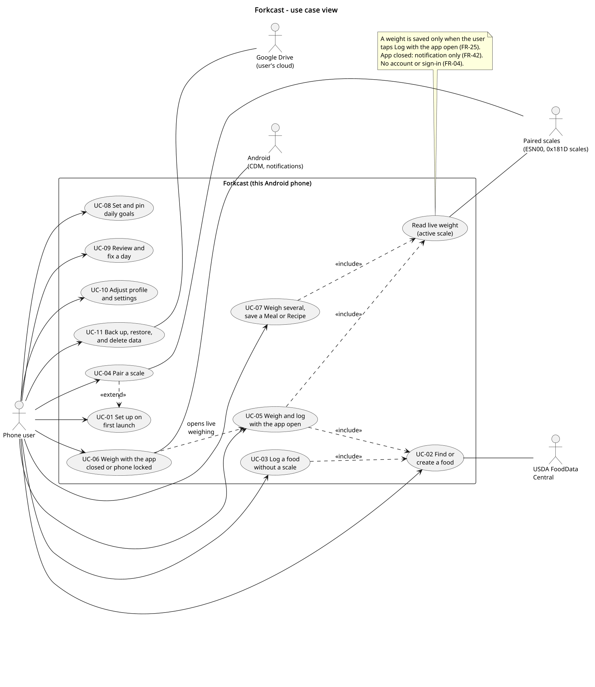
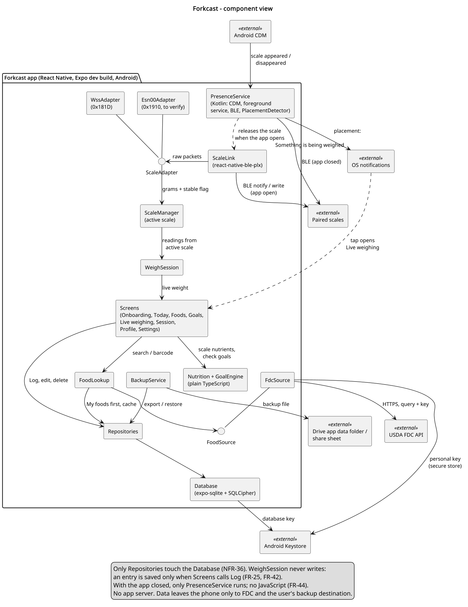
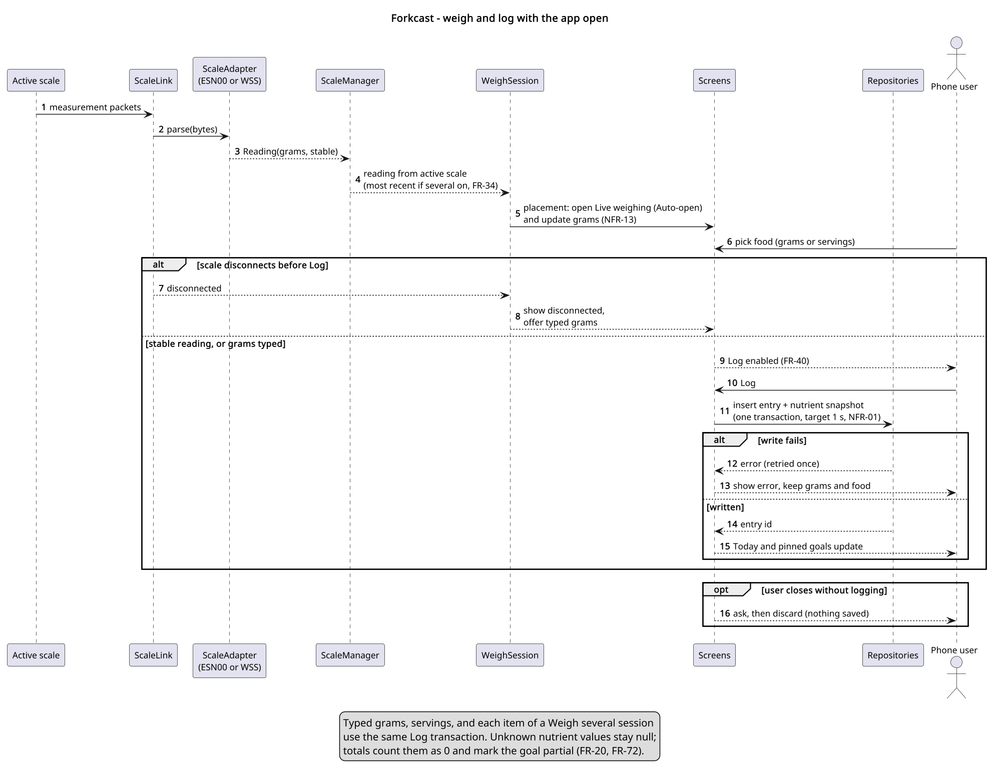
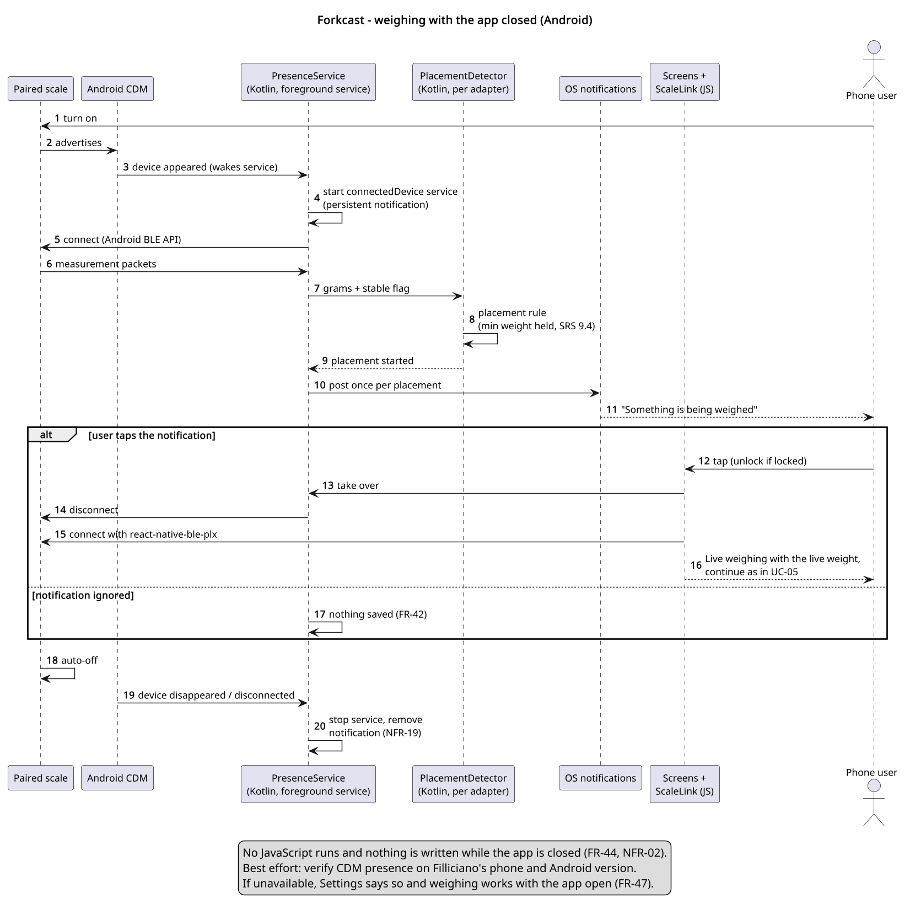
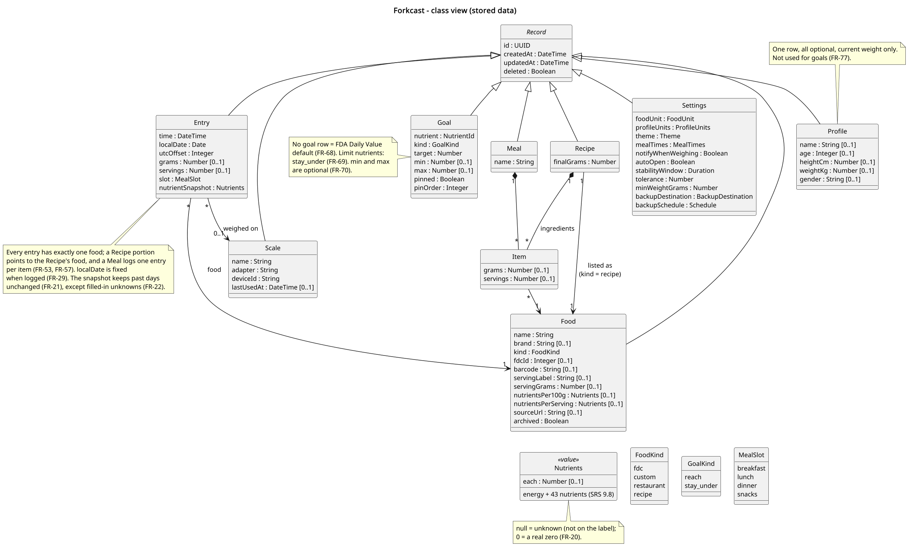
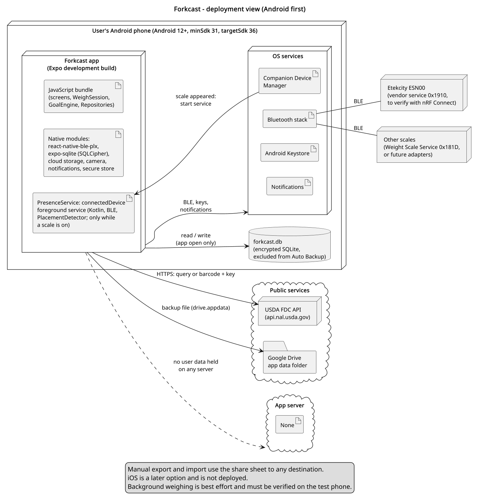
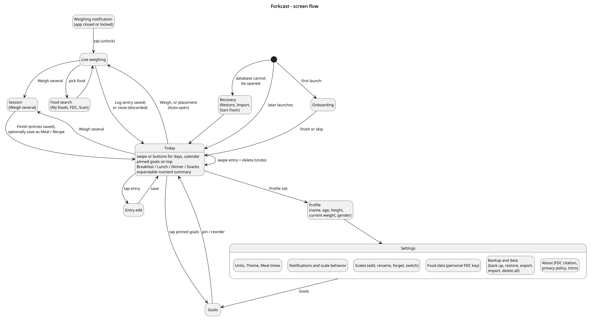
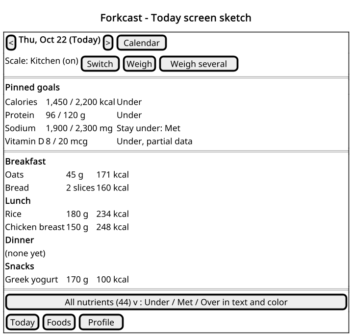

# Design Document: Forkcast

Prepared by: Filliciano Plong · Date: October 23, 2026 · Version: 1.1

**Readers:** Filliciano Plong, to build and test Forkcast's components, app-open saving, and background weighing.

## Contents

- [Revision history](#revision-history)
- [1. Context and scope](#1-context-and-scope)
- [2. Quality scenarios](#2-quality-scenarios)
- [3. Architecture views](#3-architecture-views)
- [4. Behavior and contract](#4-behavior-and-contract)
- [5. Architecture decision records](#5-architecture-decision-records)
- [6. Traceability and risk](#6-traceability-and-risk)
- [7. Maintenance and sources](#7-maintenance-and-sources)
- [8. References](#8-references)

## Revision history

| Version | Date | Changes |
|---|---|---|
| 1.0 | October 22, 2026 | Initial release. |
| 1.1 | October 23, 2026 | Added milestone table, contents page, and Navigation Pane headings. |

## 1. Context and scope

Forkcast is a local-first Android app that logs food by weight from BLE kitchen scales. Entries are saved only on Log; app-closed weighing only notifies. All data is in one encrypted on-phone database. Requirements are in the Forkcast SRS.

- Included: food lookup and logging, scale adapters, live weighing, sessions, Meals and Recipes, the app-closed notification, goals, and backup (SRS sections 1.4 and 2).
- Excluded: accounts, sync, any app server, background saving, and iOS for now (SRS section 11).

Actor: one phone user (SRS section 3). Dependencies: the scales, FDC, Google Drive, and Android Bluetooth, Companion Device Manager, notification, and Keystore services.

## 2. Quality scenarios

Numbers are SRS targets, not measurements.

| ID | Scenario | Verification |
|---|---|---|
| QS-01 Reliability | After Log, the entry is saved in one transaction within 1 second and survives the process ending. | Kill the app right after Log; the entry is there (NFR-01, UC-05). |
| QS-02 No background saving | With the app closed, weighing writes nothing. It only posts a notification. | Weigh with the phone locked and ignore it; row count unchanged (NFR-02, FR-42, UC-06). |
| QS-03 Offline | With no network, weighing, logging from My foods, typed entry, editing, and goals work. | Airplane mode with Bluetooth on (NFR-03, UC-03, UC-09). |
| QS-04 Privacy | The app sends only FDC queries (text or barcode, plus the key) and user-chosen backups. Nothing goes to a server or analytics. | Proxy capture for a day (NFR-07, NFR-08, NFR-10). |
| QS-05 Performance | Readings, search, connection, Today, and the app-closed notification meet the SRS section 5.3 targets. | Timed runs on the test phone (NFR-13 to NFR-18). |
| QS-06 Background footprint | The foreground service and its notification exist only while a scale is on and connected. | Scale on, then auto-off; notification gone within 30 s (NFR-19, FR-43). |
| QS-07 Backup integrity | A failed backup leaves the previous one restorable. A damaged or newer-version file restores nothing. | Interrupt a backup; restore on a second phone (NFR-05, FR-88, FR-89, UC-11). |
| QS-08 Data at rest | The database cannot be opened without the key; startup confirms SQLCipher; the OS backup never copies it. | cipher_version; copied file unreadable; Auto Backup excluded (NFR-09, NFR-06). |
| QS-09 Modifiability | A new scale or food source is a new adapter, with no change to weighing, goals, or logging code. | Unit tests without Bluetooth or UI (NFR-33 to NFR-37). |
| QS-10 Accessibility | TalkBack reads the stable weight and each goal's status; the main screens work at 200% font size; no state uses color alone. | TalkBack and font-size pass on Today and Live weighing (NFR-22 to NFR-26). |
| QS-11 Recoverable failures | FDC, storage, migration, and Drive failures each leave the app usable, with a clear message and no lost data. | Fault injection for each case (NFR-27 to NFR-30, FR-90). |

## 3. Architecture views

All views use the component names in Figure 2. Diagrams are UML plus one screen sketch; PlantUML sources are in the diagrams folder.

### 3.1 Use case

*Figure 1. Use case view*

**Purpose:** Show that one user performs every goal, lookup and typed logging need no scale, and app-closed weighing (UC-06) leads into in-app weighing (UC-05).

**Assumption:** No account exists. A scale is optional.

**Limitation:** Screen details and settings live in the SRS.

### 3.2 Component

*Figure 2. Component view*

**Purpose:** Show that WeighSession sees only grams and stable and never writes, Repositories are the only path to the Database, and only PresenceService runs with the app closed.

**Assumption:** The JavaScript components run in one app process. PresenceService is Kotlin in the app's native module. Nutrition and GoalEngine are plain TypeScript.

**Limitation:** Library choices are in section 5.

### 3.3 Sequence: weigh and log

*Figure 3. Weigh and log with the app open*

**Purpose:** Show in-app weighing: a stable reading, a disconnect before Log, a failed write, and closing without logging.

**Assumption:** A paired scale is on and the app is open. In a Weigh several session, each item's grams are the increase (FR-49).

**Limitation:** Typed grams, servings, and session items use the same Log transaction.

### 3.4 Sequence: app closed

*Figure 4. Weighing with the app closed*

**Purpose:** Show the background path (OD-04, OD-05): the Companion Device Manager wakes PresenceService, the Kotlin detector finds a placement, and the notification hands the scale to the app.

**Assumption:** Android 12 or later, notifications allowed, the scale associated at pairing.

**Limitation:** Best effort. Presence timing and the handover must be verified on the test phone (S-02).

### 3.5 Class

*Figure 5. Class view of stored data*

**Purpose:** Show that each entry has one food, Recipes are foods, unknown nutrients are null, goals override defaults, and records carry sync fields.

**Assumption:** Nutrients is one value type holding energy and the 43 nutrients in SRS section 9.8, per 100 g, per serving, or as an entry snapshot.

**Limitation:** Tables and indexes are not shown. Sync fields are present but no sync exists.

### 3.6 Deployment

*Figure 6. Deployment view*

**Purpose:** Show the app on an Android phone, the foreground service, the encrypted database kept out of Auto Backup, the scales over BLE, and no app server.

**Assumption:** Android first (OD-09). iOS later from the same code.

**Limitation:** Background weighing depends on the phone (section 6).

### 3.7 Screen flow

*Figure 7. Screen flow*

**Purpose:** Show how onboarding, recovery, Today, Live weighing, Session, Goals, Profile, Settings, and the weighing notification connect.

**Assumption:** Tabs are Today, Foods, and Profile; Settings opens from Profile, and Goals from the pinned goals or Settings.

**Limitation:** Foods-tab screens other than search are left out.

### 3.8 Today screen sketch

*Figure 8. Today screen sketch*

**Purpose:** Show the Today layout: day switching, Weigh and Weigh several, pinned goals with status text, entries by meal slot, and the nutrient summary.

**Assumption:** Values are examples.

**Limitation:** A sketch, not a visual design. Colors (gray, green, red) are described, not drawn.

## 4. Behavior and contract

The operation is weigh and log: WeighSession turns active-scale readings into a live weight, saved only on Log. Rules already in the SRS are cited, not restated.

| Part | Rule |
|---|---|
| Input | Active-scale readings (FR-30, FR-33) and the scale settings (FR-81, FR-85). |
| Active scale | The paired scale that is on. If several are on, the most recently used one; the user can switch (FR-34). |
| Stable | The adapter's settled flag, or else the tolerance held for the window. Only a stable reading or typed grams enable Log (FR-40). |
| Placement | Stable and placement rules are in SRS section 9.4. Auto-open and the notification fire once per placement. |
| Log | One transaction stores the entry, local date and UTC offset, and snapshot (FR-25, FR-28, FR-29, FR-21). Closing without Log asks, then discards (FR-41). |
| App closed | PresenceService notifies once per placement and writes nothing (FR-45, FR-46, FR-42, NFR-02). |
| Android background | Foreground service only while the scale is present (FR-43, NFR-19, ADR-006); Settings reports unavailability (FR-47). |
| Disconnect | The screen shows disconnected and accepts typed grams; nothing is lost because nothing was saved yet. |
| Failures | Each failure keeps the app usable: NFR-28, NFR-27, NFR-29, NFR-30. |
| Nutrient values | Missing label values are null; 0 is a real zero (FR-20). Totals count null as 0 and mark the goal partial (FR-72). |
| Goals | No goal row means the Daily Value (FR-68); limits and custom goals per FR-69 and FR-70. |
| Authorization | One local user, no account (FR-04). If permissions are denied, typed grams still work (FR-05). |

## 5. Architecture decision records

Other technology choices, which need no record of their own:

| Need | Choice |
|---|---|
| Barcode scanning | expo-camera barcode scanning (SRS section 9.10) |
| Notifications | expo-notifications for permission and channels; PresenceService posts the app-closed notification from Kotlin |
| Secure storage | Android Keystore through expo-secure-store (database key, personal FDC key) |
| Testing and linting | Jest with captured-packet fixtures, the TypeScript typecheck, and ESLint, run in CI |

### ADR-001 Local-first SQLite with SQLCipher

| Field | Record |
|---|---|
| Status | Accepted (OD-01) |
| Context | The MVP uses AsyncStorage. The SRS needs queries, migrations, encryption at rest, and no server. |
| Decision | One expo-sqlite database, reached only through Repositories (FR-86). • SQLCipher via the config plugin, key in the Keystore, cipher_version checked at startup (NFR-09). • Backup exclusion and recovery per NFR-06 and FR-90. • Migrations copy the file first (NFR-29); MVP data moves in on first launch (FR-94). |
| Alternatives | Account with a cloud database (SRS Option A). AsyncStorage. Unencrypted SQLite. |
| Benefits | No server cost, less privacy exposure, full offline use (QS-03, QS-04). UUIDs, timestamps, and soft-delete keep sync possible (NFR-36). |
| Costs | No multi-phone sync. SQLCipher needs a development build and fails silently if missing. A lost key loses the local database, so backups matter. |
| Revisit | Accounts or sync are wanted (SRS section 11). |

### ADR-002 USDA FoodData Central, cached on the device, with a user key fallback

| Field | Record |
|---|---|
| Status | Accepted (OD-03, OD-07) |
| Context | FDC is free, CC0, and has Foundation, SR Legacy, and Branded Foods with GTIN/UPC, but no restaurant data. With no server, the key ships inside the app, and FDC deactivates keys found in public. |
| Decision | FdcSource behind FoodSource (NFR-37), searched after My foods, with results cached (FR-12). • Built-in key injected at build time from untracked config (NFR-11); optional personal key (FR-14). • FDC failures degrade to local foods; a 403 offers the personal key (NFR-27). |
| Alternatives | Nutritionix, FatSecret, Edamam (paid or limited). A proxy server holding the key. Open Food Facts (future fallback). |
| Benefits | No cost, clear license, offline after first lookup, and no single point of failure in the built-in key. |
| Costs | Accepted risk: the built-in key can be extracted and revoked, removing FDC search until a personal key or app update. 1,000 requests per hour per IP. |
| Revisit | The built-in key is revoked more than once, rate limits are hit in normal use, or barcode misses are frequent. |

### ADR-003 Scale adapters: ESN00 first, plus the Weight Scale Service

| Field | Record |
|---|---|
| Status | Accepted (OD-02); ESN00 protocol to verify with nRF Connect (S-01) |
| Context | Forkcast should work with many scales. The ESN00 appears to use vendor service 0x1910 (hertzg/metekcity, unverified). A few scales use the standard Weight Scale Service (0x181D), whose finest resolution is 5 g. |
| Decision | ScaleAdapter maps packets to readings (grams, stable) and commands (tare). • Esn00Adapter first, WssAdapter as a Could (FR-35), one adapter per new model (NFR-33). • ScaleManager picks the active scale (FR-34). • TypeScript parsers tested with captured packets (NFR-34), plus a Kotlin PlacementDetector each (ADR-010). |
| Alternatives | Scale-specific code inside WeighSession. Weight Scale Service only. |
| Benefits | Weighing, goals, and logging are vendor-neutral (QS-09). Several scales can be paired (FR-32). |
| Costs | Each vendor protocol must be reverse-engineered and tested. The ESN00 notes are incomplete and disagree (type 0xD0 or 0xE0; command characteristic). |
| Revisit | nRF Connect shows the ESN00 differs from the notes, or a new scale is chosen (OD-13). |

### ADR-004 React Native and Expo development build, with react-native-ble-plx and a Kotlin module

| Field | Record |
|---|---|
| Status | Accepted |
| Context | The MVP is React Native 0.85, Expo SDK 56, expo-router, and TypeScript. BLE, SQLCipher, backup, and the Companion Device Manager need native code. |
| Decision | Keep the stack as an Expo development build, tested on a physical phone. • react-native-ble-plx for BLE with the app open. • A Kotlin Expo module for the Companion Device Manager, foreground service, and background detection (ADR-010). |
| Alternatives | Native Kotlin app. Expo Go only. |
| Benefits | One code base, ready for iOS later; reuses the MVP screens and label fields. |
| Costs | Native build setup and some Kotlin to maintain; every scale test needs a phone. |
| Revisit | A needed BLE behavior the library cannot provide, or the native module grows large. |

### ADR-005 Backup to the user's Google Drive, and file export

| Field | Record |
|---|---|
| Status | Accepted; library to confirm in validation prototype S-03 |
| Context | Local data is lost with the phone unless backed up, and there is no server. The database cannot move as a file, because its key stays in the Keystore. |
| Decision | BackupService writes the SRS section 9.7 file to the Drive app data folder with react-native-cloud-storage (FR-92), keeping two. • New file before replacing the old (NFR-05). • Export and import use the same file (FR-87); restore checks it first (FR-88). • Schedules run best effort (FR-93). |
| Alternatives | A hosted backup server. Copying the database file. Export only. Android Auto Backup (it cannot carry the Keystore key). |
| Benefits | No server; the folder is app-private. One format for Drive and export; any phone can restore it. |
| Costs | Drive needs the drive.appdata grant and consent-screen brand verification. No backup runs while the app stays closed. If the library fails S-03, use the Drive REST API. |
| Revisit | S-03 fails, iOS work starts, or sync replaces backup. |

### ADR-006 Android background weighing: Companion Device Manager and a foreground service

| Field | Record |
|---|---|
| Status | Accepted (OD-04); verify on Filliciano's phone and Android version (S-02) |
| Context | Android limits background BLE and background starts of foreground services. A connectedDevice foreground service always shows a notification. Scales turn themselves off after use. |
| Decision | Associate each scale through the Companion Device Manager and observe presence (Android 12 to 15 and 16 APIs). • PresenceService runs the connectedDevice service only while the scale is present (FR-43, NFR-19). • One notification per placement (FR-45). |
| Alternatives | A foreground service running all the time. Periodic background scans. App-open weighing only. |
| Benefits | The persistent notification shows only while weighing (QS-06). The companion association lets the app start its service from the background. |
| Costs | Presence needs Android 12 or later; timing varies by phone maker. Google Play requires a foreground service declaration (NFR-32). |
| Revisit | Presence is missed or slow on the test phone, or Play rejects the declaration. |

### ADR-007 Save weights only in the app

| Field | Record |
|---|---|
| Status | Accepted |
| Context | Saving every stable weight as an unlabeled entry would need later linking, splitting, and background writes. |
| Decision | An entry is written only when the user taps Log with the app open (FR-25). With the app closed, the system only notifies (FR-42, NFR-02). Every entry has a food. |
| Alternatives | Save-first unlabeled entries. Background auto-logging. |
| Benefits | Simpler data model and screens; no background writes to test; no orphan weights. |
| Costs | A weight is lost if the user ignores the notification or closes without logging. |
| Revisit | Missed weights turn out to be a real problem in daily use. |

### ADR-008 Goals: FDA Daily Value defaults, limits, and custom goals

| Field | Record |
|---|---|
| Status | Accepted (OD-11) |
| Context | Goals should work with no setup, show limits correctly, and stay honest when labels are incomplete. Energy estimation is out of scope. |
| Decision | GoalEngine applies Daily Value defaults (FR-68), stay-under limits (FR-69), custom goals (FR-70), and partial-data marking (FR-72). |
| Alternatives | DRI targets from age and gender as the core default. Calorie estimation from height, weight, and activity. |
| Benefits | Works immediately; matches the %DV on labels; no profile needed; the user stays in control. |
| Costs | Daily Values are general, not personal. Partial data can understate totals. |
| Revisit | Personalized targets are wanted (SRS section 11), or a week view needs goal history. |

### ADR-009 Android first, iOS later

| Field | Record |
|---|---|
| Status | Accepted (OD-09, OD-08) |
| Context | Filliciano has no iOS device to test on, and background BLE differs a lot between platforms. |
| Decision | Build, test, and release for Android first: minSdk 31, targetSdk 36 (NFR-31). Keep the code cross-platform where it is free to do so. |
| Alternatives | Both platforms at once. iOS first. |
| Benefits | Every feature can be tested on real hardware; one store's rules to meet first. |
| Costs | iOS users wait; the Kotlin module is Android-only. |
| Revisit | An iOS device is available, or the Android release is stable. |

### ADR-010 Background detection in Kotlin, not JavaScript

| Field | Record |
|---|---|
| Status | Accepted (OD-05); part of validation prototype S-02 |
| Context | With the app closed, Android may have stopped the app's process. Running the JavaScript adapters and WeighSession there would need Headless JS or a JavaScript runtime kept alive by the service. |
| Decision | PresenceService connects with BluetoothGatt; a Kotlin PlacementDetector per adapter applies SRS section 9.4 and notifies (FR-44). • No JavaScript runs while the app is closed. • On open, the service disconnects and ScaleLink reconnects. |
| Alternatives | Headless JS (background runtime start; react-native-ble-plx untested there). A JavaScript runtime kept alive by the service (memory and battery). |
| Benefits | Works after the process is stopped; small and fast to start; nothing in the background can write data (QS-02). |
| Costs | A second, minimal parser per scale model. Both parsers run the same captured-packet fixtures (NFR-35), so they cannot drift unnoticed (R12). |
| Revisit | A scale needs a two-way protocol to report weight, or S-02 shows the handover takes too long (NFR-18). |

### ADR-011 Recipes are foods; Meals log one entry per item

| Field | Record |
|---|---|
| Status | Accepted (OD-06) |
| Context | Every entry points to exactly one food. A Recipe portion and a saved Meal also need to be logged. |
| Decision | A Recipe is a Food of kind recipe (FR-55). • A Meal is a list of Items logged as one entry each (FR-52). |
| Alternatives | Let an Entry point to a Food or a Recipe. Log a Meal as one combined entry. |
| Benefits | One entry shape everywhere; Today, goals, and snapshots need no special cases. |
| Costs | A logged Meal shows as several entries. Editing a Recipe affects new entries only (FR-59). |
| Revisit | Meals need to be shown or edited as one unit on the Today screen. |

## 6. Traceability and risk

| Scenario | Design element | Check |
|---|---|---|
| QS-01 | Screens Log path, Repositories, ADR-001, ADR-007 | Kill after Log; entry present |
| QS-02 | PresenceService (no database access), ADR-007, ADR-010 | Locked-phone weigh; row count unchanged |
| QS-03 | FoodLookup, My foods cache, ADR-002 | Airplane mode weigh, log, and edit |
| QS-04 | Deployment, ADR-001, ADR-002 | Proxy capture shows only FDC and backup |
| QS-05 | ScaleLink, adapters, PresenceService, ADR-003, ADR-006 | Timed readings, connect, and notification |
| QS-06 | PresenceService, ADR-006 | Notification present only while the scale is on |
| QS-07 | BackupService, ADR-005 | Interrupted backup; restore on a second phone |
| QS-08 | Database, ADR-001 | cipher_version; copied file unreadable |
| QS-09 | ScaleAdapter, FoodSource, GoalEngine, ADR-003, ADR-008, ADR-011 | Parser, nutrient, and goal unit tests |
| QS-10 | Screens | TalkBack and 200% font pass |
| QS-11 | Repositories, FdcSource, BackupService, ADR-001, ADR-002 | Fault injection per failure |

Each SRS requirement group and the components that carry it:

| Requirements | SRS section | Components |
|---|---|---|
| FR-01 to FR-05 | 4.1 App shell | Screens |
| FR-06 to FR-09 | 4.2 First-run onboarding | Screens, Repositories |
| FR-10 to FR-17 | 4.3 Food lookup | FoodLookup, FdcSource, Repositories |
| FR-18 to FR-24 | 4.4 Custom foods and nutrient values | Screens, Nutrition, Repositories |
| FR-25 to FR-29 | 4.5 Logging | Screens, Nutrition, Repositories |
| FR-30 to FR-36 | 4.6 Scales and adapters | ScaleLink, ScaleAdapter, ScaleManager |
| FR-37 to FR-41 | 4.7 Live weighing screen | WeighSession, Screens, Nutrition |
| FR-42 to FR-47 | 4.8 Weighing with the app closed | PresenceService, PlacementDetector, ADR-006, ADR-010 |
| FR-48 to FR-59 | 4.9 Meals and recipes | WeighSession, Screens, Nutrition, Repositories, ADR-011 |
| FR-60 to FR-67 | 4.10 Today screen | Screens, Nutrition, GoalEngine, Repositories |
| FR-68 to FR-73 | 4.11 Goals | GoalEngine, Screens, ADR-008 |
| FR-74 to FR-77 | 4.12 Profile | Screens, Repositories |
| FR-78 to FR-85 | 4.13 Settings | Screens, ScaleManager, BackupService |
| FR-86 to FR-94 | 4.14 Data and backup | Repositories, Database, BackupService, ADR-005 |
| NFR-01 to NFR-06 | 5.1 Reliability | Repositories, Database, ADR-001, ADR-007 |
| NFR-07 to NFR-12 | 5.2 Security and privacy | Database, BackupService, ADR-001, ADR-005 |
| NFR-13 to NFR-19 | 5.3 Performance | WeighSession, FoodLookup, Screens, PresenceService |
| NFR-20 to NFR-21 | 5.4 Usability | Screens |
| NFR-22 to NFR-26 | 5.5 Accessibility | Screens |
| NFR-27 to NFR-30 | 5.6 Error handling | Repositories, FdcSource, BackupService |
| NFR-31 to NFR-32 | 5.7 Google Play release | Deployment view, ADR-006, ADR-009 |
| NFR-33 to NFR-37 | 5.8 Maintainability | ScaleAdapter, FoodSource, Repositories, PlacementDetector, ADR-003, ADR-010 |

Milestones, in build order. The prototype and risk tables below use these IDs.

| ID | Milestone |
|---|---|
| M1 | Project setup and encrypted storage |
| M2 | Food lookup and custom foods |
| M3 | Scale pairing and live weighing |
| M4 | Today screen and goals |
| M5 | Meals and recipes |
| M6 | Background weighing (Android) |
| M7 | Onboarding, settings, backup, and Play release |

Build order: typed logging (M2) comes before scale pairing (M3), so the app is useful without a scale. Each prototype runs before the milestone that depends on it.

| ID | Prototype | When |
|---|---|---|
| S-01 | Capture ESN00 services and packets with nRF Connect; build adapter fixtures (R1) | Before M3; can start anytime |
| S-02 | Companion Device Manager presence, the Kotlin detector, and the handover to the app on the test phone (R2, ADR-010) | Before M6 |
| S-03 | Drive app-data backup and restore with react-native-cloud-storage (ADR-005, R10) | Before M7 |

Open risks, owner Filliciano Plong. Due is the milestone by which the next step is done.

| ID | Risk | Next step | Due |
|---|---|---|---|
| R1 | ESN00 protocol unverified (one unfinished 2022 project). | S-01; base adapter tests on captures. | M3 |
| R2 | Companion Device Manager presence may be late or missing on the test phone. | S-02; fall back to app-open weighing (FR-47). | M6 |
| R3 | Google Play may question the connectedDevice foreground service. | Short declaration and demo video showing it runs only while weighing. | M7 |
| R4 | Few kitchen scales use 0x181D, and its 5 g resolution is coarse. | Treat it as a fallback; add vendor adapters one at a time (OD-13). | After M7 |
| R5 | Ignored notifications mean lost weights (ADR-007). | Watch for it in daily use. | After M7 |
| R6 | The built-in FDC key is extracted and revoked, or the hourly limit is hit. | Caching, the 400 ms search pause, HTTP 429 handling, and the personal key (FR-14). | M2 |
| R7 | SQLCipher missing from a build fails silently. | The cipher_version check fails loudly in development. | M1 |
| R8 | Play needs a privacy policy, Data safety, and the health apps declaration even with no server. | Short policy on GitHub Pages (OD-12); forms per SRS section 9.11. | M7 |
| R9 | Daily Values may be read as personal advice; partial data can understate totals. | Label defaults as a general 2,000-calorie reference; show the partial flag. | M4 |
| R10 | Backup library untested; scheduled backups run only when the app opens. | S-03; say so in Settings (FR-93). | M7 |
| R11 | FDC barcode format may not match scans (12-digit or padded). | Test real products (FR-17). | M2 |
| R12 | The TypeScript and Kotlin parsers for a scale drift apart. | Both run the same captured-packet fixtures in CI (NFR-35). | M6 |

## 7. Maintenance and sources

- Author: Filliciano Plong. Design Document version 1.1, based on the Forkcast SRS version 1.1.
- Update this document when a requirement changes, a scale adapter or external system is added, a validation prototype finishes, or OD-13 is decided. Requirements: the Forkcast SRS.
- Diagrams: PlantUML sources in the diagrams folder, rendered with PlantUML.
- Testing: a separate test plan document is recommended (SRS section 10).

## 8. References

1. OMG UML 2.5.1; arc42 overview; Michael Nygard, Documenting Architecture Decisions (2011).
2. USDA FoodData Central API guide and data documentation (fdc.nal.usda.gov). FDA Daily Value reference for the Nutrition Facts label (fda.gov).
3. hertzg/metekcity, README and packages/esn00-packet (github.com); "Hacking BLE kitchen scale" (dev.to/hertzg). nRF Connect for Mobile (Nordic Semiconductor). Bluetooth Weight Scale Service 1.0.1 (bluetooth.com).
4. Android: Companion device pairing, foreground service types, BluetoothGatt, Auto Backup, and target API level guides (developer.android.com). Google Play health apps, Data safety, and foreground service declaration help.
5. react-native-ble-plx (github.com/dotintent); Expo SQLite with SQLCipher, Expo Camera, and Expo Modules API (docs.expo.dev); React Native Cloud Storage (kuatsu); Google Drive app data folder guide (developers.google.com).
6. For later iOS work: Apple Core Bluetooth background processing guide. WCAG 2.1 (w3.org).
